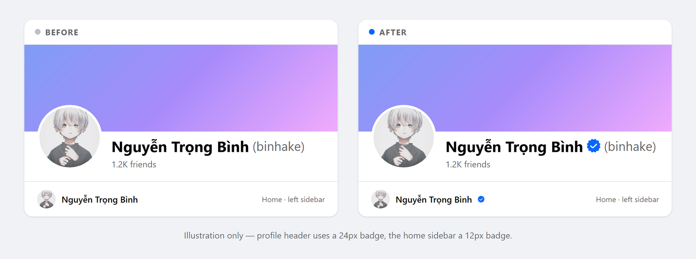
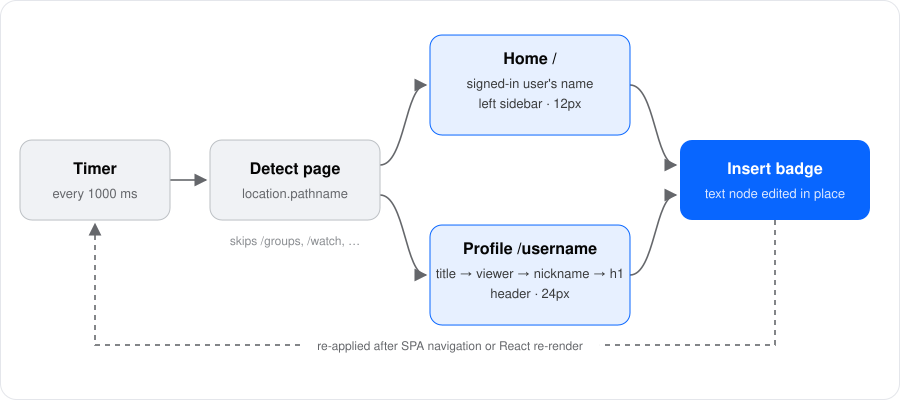
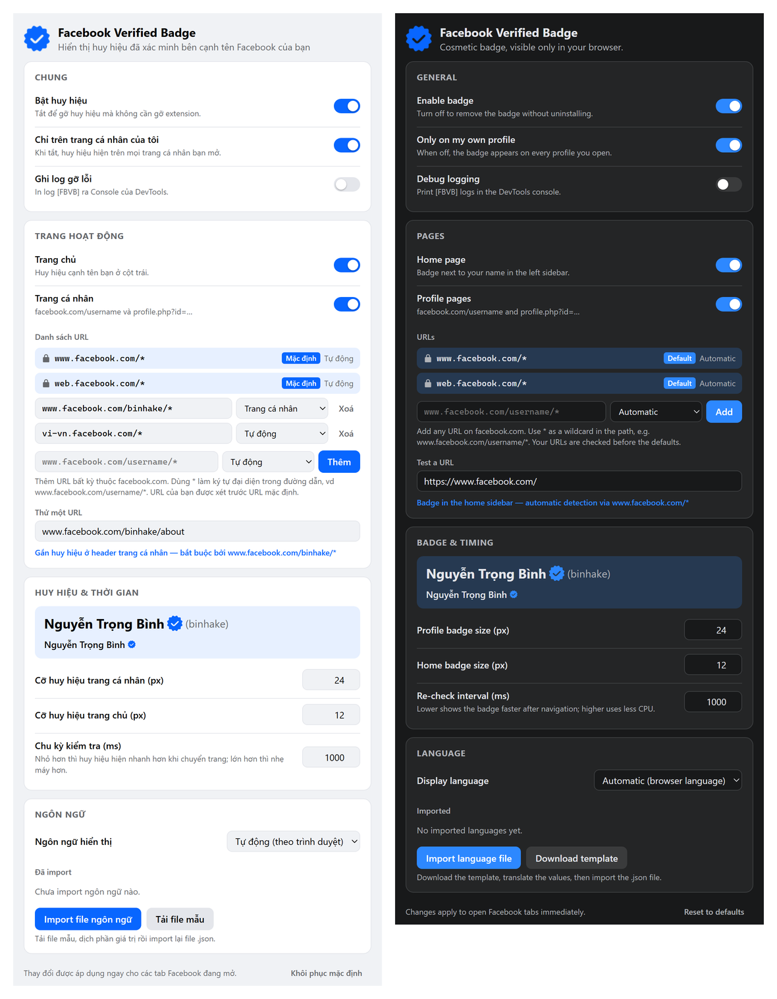

<div align="center">


# Facebook Verified Badge

Extension trình duyệt gọn nhẹ, hiển thị **huy hiệu tích xanh trang trí** cạnh tên bạn trên Facebook — ở trang chủ và trang cá nhân.

[](https://developer.chrome.com/docs/extensions/develop/migrate/what-is-mv3)
[](LICENSE)


[English](README.md) · Tiếng Việt

</div>

> [!IMPORTANT]
> Huy hiệu **chỉ là hiển thị, chỉ có trên máy bạn**. Extension chỉ sửa trang trong trình duyệt *của bạn* — tài khoản **không** hề được xác minh và người khác **không** nhìn thấy huy hiệu. Đừng dùng nó để giả mạo tài khoản đã xác minh hay lừa người khác.

---

## Mục lục

- [Hình minh hoạ](#hình-minh-hoạ)
- [Tính năng](#tính-năng)
- [Cách hoạt động](#cách-hoạt-động)
- [Cài đặt](#cài-đặt)
- [Tuỳ chỉnh](#tuỳ-chỉnh)
- [Danh sách URL](#danh-sách-url)
- [Ngôn ngữ](#ngôn-ngữ)
- [Xử lý sự cố](#xử-lý-sự-cố)
- [Cấu trúc dự án](#cấu-trúc-dự-án)
- [Quyền riêng tư](#quyền-riêng-tư)
- [Giới hạn](#giới-hạn)
- [Đóng góp](#đóng-góp)
- [Giấy phép](#giấy-phép)

## Hình minh hoạ



| Trang | Vị trí huy hiệu | Kích thước |
|---|---|---|
| Trang chủ — `www.facebook.com/` hoặc `web.facebook.com/` (có `?…&…` vẫn được) | Tên bạn ở cột trái | 12 px |
| Trang cá nhân — `facebook.com/<username>` hoặc `profile.php?id=<id>` | Tên ở header, đứng trước ` (biệt danh)` nếu có | 24 px |

## Tính năng

- **Giao diện tuỳ chỉnh.** Bấm icon extension trên thanh công cụ để bật/tắt huy hiệu, đổi kích thước, chu kỳ, bật log gỡ lỗi hay đổi ngôn ngữ — áp dụng ngay cho các tab Facebook đang mở.
- **Thêm ngôn ngữ tuỳ ý.** Có sẵn tiếng Anh và tiếng Việt; tải file mẫu, dịch rồi import bất kỳ ngôn ngữ nào dưới dạng file `.json`.
- **Tuỳ chỉnh URL.** Có sẵn `www.facebook.com` và `web.facebook.com`; thêm URL bất kỳ thuộc `facebook.com` (hỗ trợ ký tự đại diện `*`) và chọn cách xử lý.
- **Ít quyền nhất có thể.** Chỉ xin `storage` (để nhớ tuỳ chọn) và một content script trên `facebook.com`; không background, không gửi request.
- **Giống hệt huy hiệu thật.** Markup chèn vào sao chép đúng cấu trúc huy hiệu của Facebook (cùng class, màu `--accent`), nên tự đổi theo giao diện sáng/tối.
- **Ai cài cũng chạy.** Tên tài khoản đang đăng nhập được đọc từ dữ liệu Facebook nhúng sẵn trong trang, không cần sửa code.
- **Hiểu SPA.** Facebook không tải lại trang khi chuyển trang; extension kiểm tra lại mỗi giây, gỡ huy hiệu cũ khi đổi URL và tự gắn lại nếu React vẽ lại phần tên.
- **An toàn với React.** Sửa trực tiếp text node có sẵn thay vì thay cả element, dựng huy hiệu bằng DOM API (không `innerHTML`) nên không xung đột React / Trusted Types.
- **Tự chọn ngôn ngữ.** Mặc định trang tuỳ chỉnh và tooltip huy hiệu theo ngôn ngữ trình duyệt, không có thì dùng tiếng Anh.

## Cách hoạt động



1. **Nhận dạng trang** theo `location.pathname`:
   - `/` hoặc `/home.php` → *trang chủ*
   - path 1 cấp trông giống username (5–50 ký tự `A–Z a–z 0–9 .`) hoặc `/profile.php?id=…` → *trang cá nhân*
   - các path dành riêng như `/groups`, `/watch`, `/marketplace`, `/reels`, … bị bỏ qua.
2. **Tìm element chứa tên.** Chỉ xét element có text *trực tiếp* đúng bằng tên, và bỏ qua mọi thứ nằm trong bài viết, feed, popup (`[role="article"]`, `[role="feed"]`, `[role="dialog"]`).

   | Trang | Thứ tự cách tìm |
   |---|---|
   | Trang chủ | 1. Tên tài khoản đang đăng nhập (từ `CurrentUserInitialData`), ưu tiên ở cột điều hướng bên trái · 2. Dự phòng: `span.x1lliihq` đầu tiên đang hiển thị và có chữ |
   | Trang cá nhân | 1. Tên trong `<title>` (`(3) Nguyễn Trọng Bình \| Facebook`) · 2. Tên tài khoản đang đăng nhập trong `h1` / `[role="main"]` · 3. `span.x1lliihq` có chứa span biệt danh · 4. Text bất kỳ đang hiển thị trong `[role="main"] h1` |

   Cần nhiều cách vì Facebook không phải lúc nào cũng đổi `<title>` khi chuyển trang (có lúc vẫn để `(1) Facebook`), và DOM khác nhau giữa các tài khoản / bản thử nghiệm A/B.
3. **Chèn huy hiệu.** Text tên được chuẩn hoá thành `Tên&nbsp;`, huy hiệu được chèn trước span biệt danh (hoặc cuối element):

   ```html
   <span class="x1lliihq" data-fbvb="">
     Nguyễn Trọng Bình&nbsp;
     <span data-fbvb-badge="">
       <div class="x1rg5ohu"><span class="xjp7ctv"><div tabindex="0">
         <span class="x3nfvp2 x11njtxf">
           <svg viewBox="0 0 24 24" width="24" height="24" fill="currentColor" role="img" …>
             <title>Tài khoản đã xác minh</title><path d="…"/>
           </svg>
         </span>
       </div></span></div>
     </span>
     <span class="x1q74xe4 x1fcty0u"> (binhake)</span>
   </span>
   ```

   `data-fbvb` / `data-fbvb-badge` đánh dấu chỗ đã sửa để không bao giờ chèn trùng.

## Cài đặt

Extension chưa có trên Chrome Web Store; cài ở chế độ nhà phát triển. Chạy được trên mọi trình duyệt nhân Chromium (Chrome, Edge, Brave, Opera, Cốc Cốc, …).

1. **Tải code**
   ```bash
   git clone https://github.com/binhake/Facebook_Verified_Badge.git
   ```
   hoặc tải ZIP trên GitHub (**Code → Download ZIP**) rồi giải nén.
2. **Mở trang quản lý extension**
   - Chrome / Brave / Cốc Cốc: `chrome://extensions`
   - Edge: `edge://extensions`
3. Bật **Developer mode** (Chế độ dành cho nhà phát triển).
4. Bấm **Load unpacked** (Tải tiện ích đã giải nén) và chọn thư mục chứa `manifest.json`.
5. Mở hoặc tải lại Facebook.
6. Tuỳ chọn: ghim extension từ menu hình mảnh ghép để mở phần tuỳ chỉnh chỉ với một cú bấm.

Cập nhật: kéo code mới (hoặc giải nén ZIP mới đè lên thư mục cũ), bấm **Reload** trên thẻ extension rồi tải lại Facebook.

> [!NOTE]
> Hãy chọn **thư mục**, đừng cài file `.crx`. Trình duyệt Chromium tự tắt các extension `.crx` không đến từ cửa hàng chính thức.

## Tuỳ chỉnh

Bấm icon extension trên thanh công cụ (ghim trước từ menu mảnh ghép), hoặc vào **Chi tiết → Tuỳ chọn tiện ích** ở `chrome://extensions`. Mọi thay đổi được lưu tự động và áp dụng ngay cho các tab Facebook đang mở — không cần tải lại.



| Tuỳ chọn | Mặc định | Ý nghĩa |
|---|---|---|
| Bật huy hiệu | Bật | Tắt để gỡ mọi huy hiệu mà không cần gỡ extension. |
| Chỉ trên trang cá nhân của tôi | Bật | Bật: chỉ gắn trên trang của tài khoản đang đăng nhập. Tắt: gắn trên mọi trang cá nhân bạn mở. |
| Ghi log gỡ lỗi | Tắt | In từng bước ra Console (DevTools) với tiền tố `[FBVB]` (xem [Xử lý sự cố](#xử-lý-sự-cố)). |
| Cỡ huy hiệu trang cá nhân | `24` px | Trong khoảng 8–64. |
| Cỡ huy hiệu trang chủ | `12` px | Trong khoảng 8–48. |
| Chu kỳ kiểm tra | `1000` ms | Trong khoảng 250–10000. Nhỏ hơn = huy hiệu hiện nhanh hơn khi chuyển trang; lớn hơn = nhẹ máy hơn. |
| Trang chủ | Bật | Huy hiệu ở trang chủ (`/`). |
| Trang cá nhân | Bật | Huy hiệu ở `/username` và `/profile.php?id=…`. |
| Danh sách URL | 2 URL mặc định | Nơi extension hoạt động — xem [Danh sách URL](#danh-sách-url). |
| Ngôn ngữ hiển thị | Tự động | Ngôn ngữ của trang tuỳ chỉnh và tooltip huy hiệu. *Tự động* theo ngôn ngữ trình duyệt. |
| Khôi phục mặc định | — | Đưa các tuỳ chọn trên về mặc định và xoá URL bạn đã thêm. Ngôn ngữ đã import được giữ lại. |

Tuỳ chọn được lưu bằng `chrome.storage.sync`, nên đi theo hồ sơ trình duyệt nếu bạn bật đồng bộ.

## Danh sách URL

Mục **Trang hoạt động → Danh sách URL** quyết định huy hiệu được phép xuất hiện ở đâu.

| URL | Chế độ | |
|---|---|---|
| `www.facebook.com/*` | Tự động | 🔒 Mặc định — không sửa, không xoá, không thêm lại được |
| `web.facebook.com/*` | Tự động | 🔒 Mặc định — không sửa, không xoá, không thêm lại được |
| *URL của bạn* | Tự động / Trang cá nhân / Trang chủ / Tắt | Sửa và xoá được, tối đa 30 URL |

**Thêm URL**

- Nhập URL rồi bấm **Thêm**. Không cần gõ `https://`; nhập mỗi tên miền như `vi-vn.facebook.com` sẽ thành `vi-vn.facebook.com/*`.
- Chỉ chấp nhận `facebook.com` và tên miền con của nó — `google.com` hay `facebook.com.example.net` đều bị từ chối.
- `*` khớp mọi ký tự trong đường dẫn: `www.facebook.com/binhake/*` áp dụng cho `/binhake/about`, `/binhake/photos`, …
- URL trùng (kể cả trùng 2 URL mặc định, viết hoa/thường khác nhau) đều bị từ chối.

**Chế độ**

| Chế độ | Cách hoạt động |
|---|---|
| Tự động | Tự nhận dạng loại trang: `/` → trang chủ, `/username` hoặc `/profile.php?id=…` → trang cá nhân, còn lại → không gắn. Tuân theo công tắc **Trang chủ** / **Trang cá nhân**. |
| Trang cá nhân | Luôn tìm tên ở header trang cá nhân (vd `/binhake/about`). |
| Trang chủ | Luôn tìm tên tài khoản đang đăng nhập ở cột trái. |
| Tắt | Không bao giờ gắn huy hiệu ở các trang khớp (vd trang cá nhân của một người bạn). |

URL của bạn được xét từ trên xuống **trước** URL mặc định, nên quy tắc cụ thể như `www.facebook.com/someone` → *Tắt* sẽ thắng `www.facebook.com/*`. Dùng ô **Thử một URL** để xem quy tắc nào được áp dụng và kết quả ra sao.

> [!NOTE]
> Có thể thêm các tên miền con khác (vd `m.facebook.com`, `mbasic.facebook.com`), nhưng giao diện của chúng khác bản desktop nên có thể không tìm được tên.

## Ngôn ngữ

Trang tuỳ chỉnh và tooltip huy hiệu (`title` của huy hiệu) dịch được. Tiếng Anh và tiếng Việt có sẵn; ngôn ngữ khác thêm ngay trong trang tuỳ chỉnh:

1. Bấm **Tải file mẫu** — nhận file `fbvb-language-template.json` chứa toàn bộ chuỗi tiếng Anh.
2. Đặt `code` (mã [ISO 639-1](https://vi.wikipedia.org/wiki/Danh_s%C3%A1ch_m%C3%A3_ISO_639-1), có thể kèm vùng như `pt-BR`) và `name`, rồi dịch phần giá trị trong `messages`. Giữ nguyên các khoá và `{placeholder}`.
3. Bấm **Import file ngôn ngữ** và chọn file `.json`. Ngôn ngữ mới xuất hiện trong danh sách **Ngôn ngữ hiển thị** và mục **Đã import**, xoá được bất cứ lúc nào.

```json
{
  "code": "fr",
  "name": "Français",
  "messages": {
    "badgeTitle": "Compte vérifié",
    "optionsSubtitle": "Badge décoratif, visible uniquement dans votre navigateur.",
    "importSuccess": "Langue importée : {name}"
  }
}
```

- Khoá nào thiếu sẽ dùng bản tiếng Anh, nên dịch một phần vẫn được.
- Khoá lạ bị bỏ qua và chỉ giữ giá trị dạng chữ; không gì trong file được thực thi, chuỗi được chèn dưới dạng text chứ không phải HTML.
- Import ngôn ngữ trùng `code` với ngôn ngữ có sẵn (`en`, `vi`) sẽ ghi đè; xoá bản import thì quay về bản có sẵn.
- Ngôn ngữ đã import được lưu cục bộ (`chrome.storage.local`) trên trình duyệt hiện tại.

Muốn bản dịch của bạn có sẵn trong extension? Mở pull request thêm vào `BUILTIN_LANGUAGES` trong [`src/shared/settings.js`](src/shared/settings.js).

> [!NOTE]
> Khi mở tuỳ chỉnh dạng popup trên thanh công cụ, nút **Import file ngôn ngữ** sẽ mở trang tuỳ chỉnh đầy đủ trong tab mới, vì hộp chọn file làm popup tự đóng.

## Xử lý sự cố

**Không thấy huy hiệu**

1. Kiểm tra extension đang bật, **Bật huy hiệu** đang bật, và đã **Reload** extension sau khi sửa code.
2. Dán địa chỉ trang vào ô **Thử một URL** trong phần tuỳ chỉnh: nó cho biết trang đó có được gắn huy hiệu không và quy tắc nào quyết định. Thêm URL nếu cần (xem [Danh sách URL](#danh-sách-url)).
3. Bật **Ghi log gỡ lỗi** trong phần tuỳ chỉnh, tải lại Facebook, mở DevTools (<kbd>F12</kbd>) → **Console** và lọc `FBVB`:

   | Log | Ý nghĩa |
   |---|---|
   | *(không có gì)* | Content script không chạy — kiểm tra extension đã bật chưa. |
   | `Skipped <url>: <reason> (<rule>)` | Trang này không gắn huy hiệu. Lý do: `noRule` (URL không có trong danh sách), `off` (bị quy tắc tắt), `typeOff` (công tắc Trang chủ/Trang cá nhân đang tắt), `unsupported` (không phải trang chủ hay trang cá nhân), `disabled` (huy hiệu đang tắt). |
   | `Signed-in user not found yet …` | Chưa đọc được dữ liệu tài khoản; trang chủ dùng cách dự phòng (span tên đầu tiên). |
   | `Profile: name not found …` | Không tìm thấy element phù hợp. Log liệt kê title, tên tài khoản và mọi `h1` — hãy gửi kèm khi tạo issue. |
   | `Badge (24px) added next to "…"` | Đã chạy đúng. |

**Đoạn lệnh chẩn đoán**

Khi tạo issue, hãy chạy đoạn dưới trong Console **ngay trên trang không hiện huy hiệu** rồi dán kết quả (đã tự copy vào clipboard). Đoạn lệnh chỉ đọc trang, không gửi gì đi đâu.

```js
(() => {
  const norm = t => t.replace(/[\u00a0\s]+/g, ' ').trim();
  const own = el => norm([...el.childNodes].filter(n => n.nodeType === 3).map(n => n.data).join(''));
  const path = el => {
    const p = [];
    for (let e = el; e && e !== document.body && p.length < 8; e = e.parentElement) {
      p.push(e.tagName.toLowerCase()
        + (e.getAttribute('role') ? '[role=' + e.getAttribute('role') + ']' : '')
        + (e.classList.contains('x1lliihq') ? '.x1lliihq' : ''));
    }
    return p.reverse().join(' > ');
  };
  let viewer = null;
  for (const s of document.scripts) {
    const m = s.textContent.match(/"CurrentUserInitialData",\[\],\{[^{}]*?"NAME":"((?:[^"\\]|\\.)*)"/);
    if (m) { viewer = JSON.parse('"' + m[1] + '"'); break; }
  }
  const lines = [
    'URL: ' + location.href,
    'title: ' + document.title,
    'viewer: ' + viewer,
    'h1 count: ' + document.querySelectorAll('h1').length,
    ...[...document.querySelectorAll('h1')].map(h =>
      '  ' + path(h) + ' | visible=' + (h.getClientRects().length > 0) + ' | ' + h.outerHTML.slice(0, 400))
  ];
  if (viewer) {
    const hits = [...document.querySelectorAll('body *')].filter(e => own(e) === norm(viewer));
    lines.push('elements whose text = viewer name: ' + hits.length);
    hits.slice(0, 15).forEach(e =>
      lines.push('  ' + path(e) + ' | visible=' + (e.getClientRects().length > 0) + ' | ' + e.outerHTML.slice(0, 300)));
  }
  const report = lines.join('\n');
  console.log(report);
  copy(report);
})();
```

> [!TIP]
> Chrome có thể yêu cầu gõ `allow pasting` trước khi cho dán code vào Console. Facebook cũng hiện cảnh báo lớn "Stop!" ở đó — cảnh báo nhắm vào các đoạn script đánh cắp tài khoản; luôn đọc kỹ một đoạn lệnh trước khi chạy.

## Cấu trúc dự án

```
Facebook_Verified_Badge/
├── manifest.json            # Manifest V3: content script, popup, trang tuỳ chỉnh
├── src/
│   ├── content.js           # Nhận dạng trang, tìm tên, chèn huy hiệu
│   ├── shared/
│   │   └── settings.js      # Mặc định, lưu trữ, ngôn ngữ có sẵn, import ngôn ngữ
│   └── options/
│       ├── options.html     # Giao diện tuỳ chỉnh (popup + tab tuỳ chọn)
│       ├── options.css
│       └── options.js
├── _locales/                # Tên/mô tả extension cho trình duyệt (en, vi)
├── icons/                   # Icon 16 / 48 / 128 px
├── docs/images/             # Hình minh hoạ cho README
├── CHANGELOG.md
├── LICENSE
├── README.md                # Tiếng Anh
└── README.vi.md             # Tiếng Việt
```

## Quyền riêng tư

- Quyền duy nhất là `storage`, dùng để lưu tuỳ chọn và ngôn ngữ đã import. Content script được nạp trên `*.facebook.com` và không làm gì nếu trang không khớp URL nào trong danh sách.
- Tên và ID tài khoản được đọc từ trang hiện tại trong bộ nhớ, chỉ dùng để tìm vị trí tên trên màn hình, không lưu và không gửi đi.
- Không analytics, không tải code từ xa, không có request mạng.

## Giới hạn

- Phụ thuộc vào markup của Facebook (vd `span.x1lliihq`, thuộc tính `role`). Facebook đổi giao diện thường xuyên nên có thể cần cập nhật selector — hãy tạo issue kèm kết quả đoạn lệnh chẩn đoán.
- Trên trang cá nhân **của người khác**, tên được tìm qua `<title>` hoặc tiêu đề trang; nếu Facebook để title là `Facebook` và tên không nằm trong `h1` thì sẽ không có huy hiệu.
- Chỉ hỗ trợ giao diện desktop. Bản mobile (`m.facebook.com`), Messenger, Trang/Nhóm thêm vào danh sách URL được nhưng thường sẽ không hiện huy hiệu.
- Huy hiệu chỉ để trang trí: không xuất hiện trên thiết bị, trình duyệt khác hay với người khác.

## Đóng góp

Rất hoan nghênh issue và pull request.

1. Fork repo và tạo nhánh: `git checkout -b fix/profile-selector`.
2. Không thêm thư viện ngoài, hạn chế xin thêm quyền.
3. Theo đúng phong cách code hiện có (thụt 2 dấu cách, nháy đơn, khai báo `function`; xem `.editorconfig`).
4. Thử trên cả `/` và một trang `/username` với **Ghi log gỡ lỗi** đang bật trước khi mở PR.
5. Chuỗi giao diện mới phải thêm vào mọi ngôn ngữ trong `BUILTIN_LANGUAGES` (tiếng Anh là dự phòng).
6. Mô tả thay đổi; với các sửa selector, kèm kết quả đoạn lệnh chẩn đoán làm căn cứ.

## Giấy phép

[MIT](LICENSE) © 2026 Nguyễn Trọng Bình ([@binhake](https://github.com/binhake))

---

<sub>Dự án không liên kết, không được bảo trợ hay tài trợ bởi Meta Platforms, Inc. "Facebook" là nhãn hiệu của Meta Platforms, Inc.</sub>
